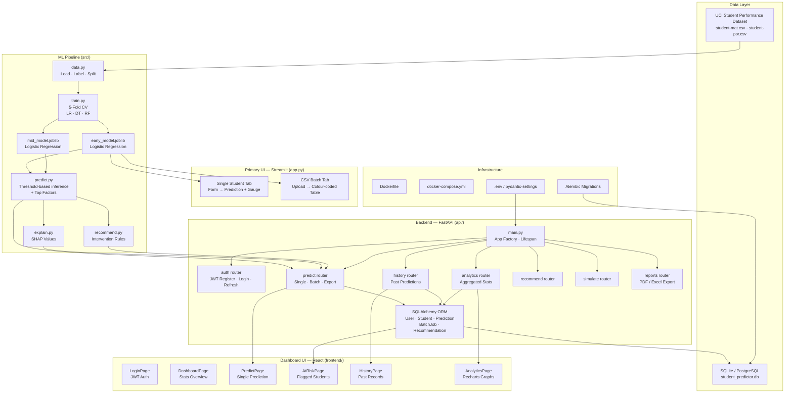
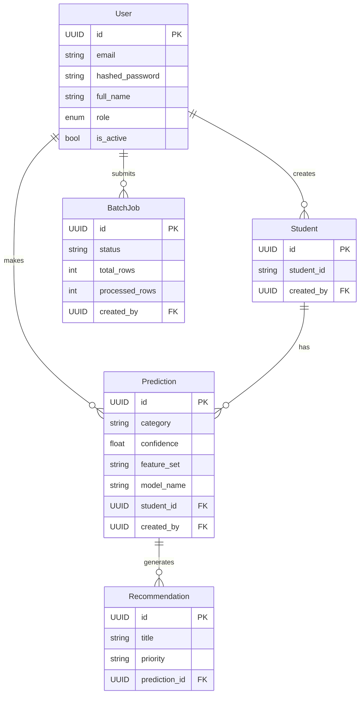
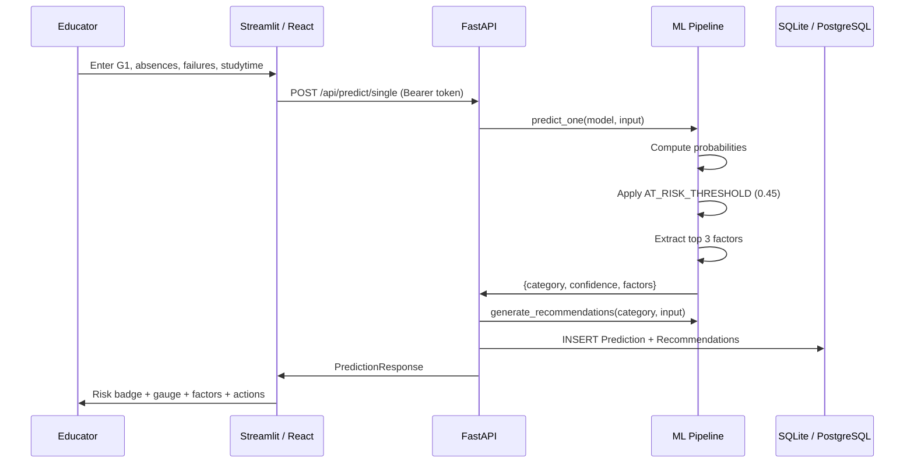

# System Architecture — AI Student Performance Predictive System

> A decision-support tool that predicts student risk levels (Performing Well / Needs Improvement / At-Risk) using first and second period grades, attendance, and study habits.

---

## High-Level Architecture



---

## Component Breakdown

### 1. ML Pipeline

| File | Responsibility |
|------|---------------|
| `src/data.py` | Loads UCI CSVs, merges maths + Portuguese datasets, creates 3-class label from G3 score |
| `src/train.py` | Runs 5-fold stratified CV across Logistic Regression, Decision Tree, Random Forest; selects winner by At-Risk recall → macro-F1 |
| `src/predict.py` | Threshold-based inference (`AT_RISK_THRESHOLD = 0.45`), feature importance extraction, batch prediction |
| `src/explain.py` | SHAP TreeExplainer / LinearExplainer for per-feature impact values |
| `src/recommend.py` | Rule-based intervention engine — generates high/medium/low priority actions based on prediction category and input values |
| `src/validate.py` | Input sanitisation for single-student forms and CSV uploads |

#### Labelling Rules

| G3 Score | Category |
|----------|----------|
| 14 – 20 | ✅ Performing Well |
| 8 – 13 | ⚠️ Needs Improvement |
| 0 – 7 | 🚨 At-Risk |

#### Model Selection Results

| Model | CV Accuracy | At-Risk Recall | CV Macro-F1 | Selected |
|-------|-------------|---------------|-------------|---------|
| Logistic Regression | 81.2% | **88.8%** | **77.5%** | ✅ Early |
| Decision Tree | 81.8% | 75.0% | 76.6% | — |
| Random Forest | 83.8% | 51.3% | 76.2% | — |

> Random Forest had the highest accuracy but the lowest At-Risk recall — it missed too many struggling students. Logistic Regression was selected because catching At-Risk students is the primary objective.

---

### 2. FastAPI Backend

**Base URL:** `http://localhost:8000`  
**Interactive docs:** `http://localhost:8000/docs`

| Router | Prefix | Key Endpoints |
|--------|--------|--------------|
| Auth | `/api/auth` | `POST /register`, `POST /login`, `POST /refresh`, `GET /me` |
| Predict | `/api/predict` | `POST /single`, `POST /batch-process`, `POST /upload-validate`, `GET /template` |
| History | `/api/history` | `GET /` — paginated past predictions |
| Analytics | `/api/analytics` | Aggregated category distributions and trends |
| Recommend | `/api/recommend` | Rule-based intervention suggestions |
| Simulate | `/api/simulate` | What-if scenario modelling |
| Reports | `/api/reports` | PDF / Excel export |

**Auth flow:** `POST /login` → JWT access token (30 min) + refresh token (7 days) → Bearer header on all protected routes.

#### Database Models



---

### 3. Streamlit App (Primary Demo Interface)

```
streamlit run app.py → http://localhost:8501
```

| Tab | Features |
|-----|---------|
| Single Student | Grade / absence / studytime form → animated SVG confidence gauge → top 3 factors → intervention recommendations |
| CSV Batch Upload | Template download → upload → colour-coded risk table → results download |

---

### 4. React Dashboard

```
cd frontend && npm run dev → http://localhost:5173
```

| Page | Route | Description |
|------|-------|-------------|
| Login | `/login` | JWT authentication |
| Dashboard | `/` | At-risk count, category distribution |
| Predict | `/predict` | Single-student form via API |
| At-Risk | `/at-risk` | Filtered list of flagged students |
| History | `/history` | Paginated prediction log |
| Analytics | `/analytics` | Recharts trend graphs |

**State management:** Redux Toolkit  
**API layer:** Axios client in `frontend/src/api/`  
**Auth:** JWT stored in context, attached as Bearer token to every API call

---

### 5. Infrastructure

| File | Purpose |
|------|---------|
| `.env` | Local config (SQLite DB, dev secret key) |
| `.env.example` | Template for production setup (PostgreSQL) |
| `Dockerfile` | Containerises the FastAPI backend |
| `docker-compose.yml` | Orchestrates API + PostgreSQL |
| `alembic.ini` + `migrations/` | Database schema versioning |

---

## Data Flow — Single Prediction



---

## Running the Project

### Option A — Streamlit only (simplest)
```bash
pip install -r requirements.txt
python src/train.py        # only needed once
streamlit run app.py
```

### Option B — Full stack
```bash
# Terminal 1
uvicorn api.main:app --reload

# Terminal 2
cd frontend && npm install && npm run dev
```

### Option C — Docker
```bash
docker-compose up
```

---

## Test Coverage

| Suite | Tests | Status |
|-------|-------|--------|
| `test_data.py` | 5 | ✅ Pass |
| `test_predict.py` | 8 | ✅ Pass |
| `test_validate.py` | 16 | ✅ Pass |
| `test_api_auth.py` | 3 | ✅ Pass |
| `test_api_predict.py` | 6 | ✅ Pass |
| **Total** | **68** | ✅ **0 failures** |

```bash
pytest tests/ -v   # run all 68 tests
```

---

## Limitations

- **Dataset size:** ~1,000 records from one school in Portugal. Results may not generalise to other educational contexts.
- **Features available:** Only grades, absences, study time, and past failures. Assignment scores and coursework were not in the UCI dataset.
- **Decision support only:** Predictions should complement, not replace, educator judgment.
- **Demographic fairness:** Sex, age, and other demographic columns are excluded from model inputs to reduce bias.
